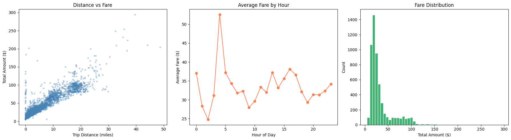

# Assignment 1 — NYC Taxi Fare Prediction

Kaggle course assignment: predict `total_amount` paid for a taxi ride.
**Kaggle score:** _add_ · **Cutoff:** _add_ · **Competition:** _add link_

## Data
10,000 training rides, 1,500 test rides. Pickup/dropoff timestamps, distance, rate code, passenger count, surcharges, payment type. See [`problem_statement.txt`](problem_statement.txt).

## Approach
- Dropped 366 rows (3.6 %) where passenger count, rate code and surcharges were jointly missing.
- Derived `trip_duration_min` from timestamps. It exposed bad records (negative durations, a 1,483-minute trip), which were filtered.
- Removed impossible fares (negative / < $2.50) and extreme outliers.
- Added hour, day of week, month, weekend flag.
- Dropped `tip_amount` and `improvement_surcharge` to avoid leaking components of the target.
- Compared 7 regressors, then grid-searched the top three.

## Results (80/20 split)

| Model | R² | MAE | RMSE |
|-------|----|-----|------|
| Random Forest (tuned) | 0.9303 | 3.53 | 7.42 |
| Random Forest | 0.9295 | 3.57 | 7.47 |
| XGBoost (tuned) | 0.9279 | 3.42 | 7.55 |
| Linear Regression | 0.8925 | 4.72 | 9.22 |

The submitted pipeline re-did cleaning on unscaled data (scaler fit on train only) with tighter filters and a Random Forest (100 trees, depth 10): local R² 0.957. That figure is on a more aggressively filtered set, so it isn't directly comparable to the table.

## Notebook
[`taxi_fare_regression.ipynb`](taxi_fare_regression.ipynb)
