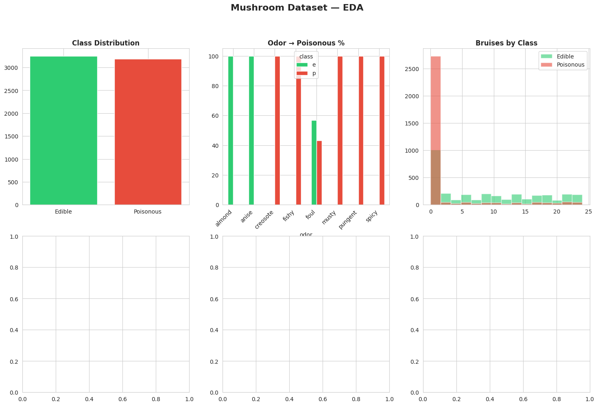
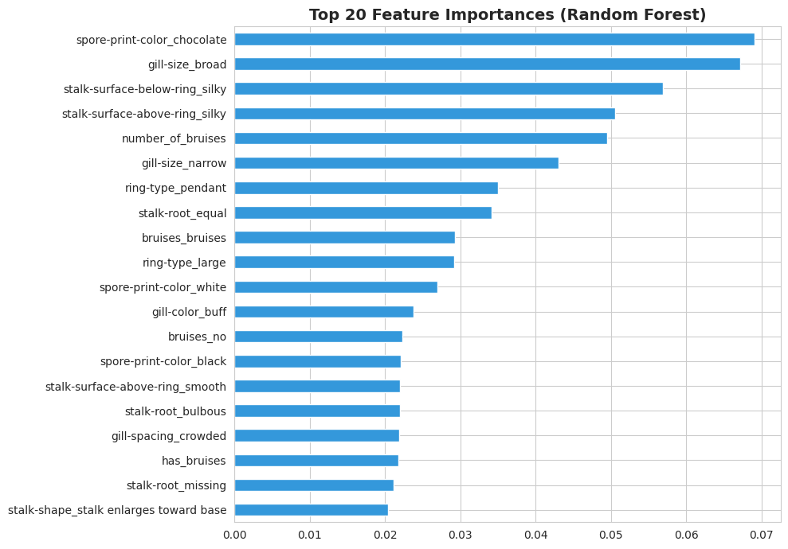

# Assignment 2 — Mushroom Edibility Classification

Kaggle course assignment: classify mushrooms as edible (`e`) or poisonous (`p`). Metric: accuracy.
**Kaggle score:** _add_ · **Cutoff:** _add_ · **Competition:** _add link_

## Data
7,000 training rows, 1,124 test rows; 24 categorical/numeric traits (cap shape, odor, gill colour, habitat…). See [`problem_statement.txt`](problem_statement.txt).

## Approach
- Imputed missing `odor`, `stalk-root`, `ring-type` (mode) and `ring-number` (median), using **training** statistics for the test set.
- IQR-based outlier removal on the two numeric columns.
- Engineered features: dangerous-odor flag, stalk colour/surface match above vs below the ring, ring present, bruises flag.
- One-hot encoding, scaler fit on train only, stratified 80/20 split.
- Benchmarked 7 classifiers, tuned the top 3 with 5-fold grid search.

## Results
Logistic Regression, Ridge, L1-Logistic, Decision Tree, Random Forest and others all reached **100 % validation accuracy** (F1 = AUC = 1.0). Odor alone is almost perfectly predictive of toxicity, so the dataset is close to linearly separable; the simplest model (Logistic Regression) was submitted.

## Notebook
[`mushroom_classification.ipynb`](mushroom_classification.ipynb)
