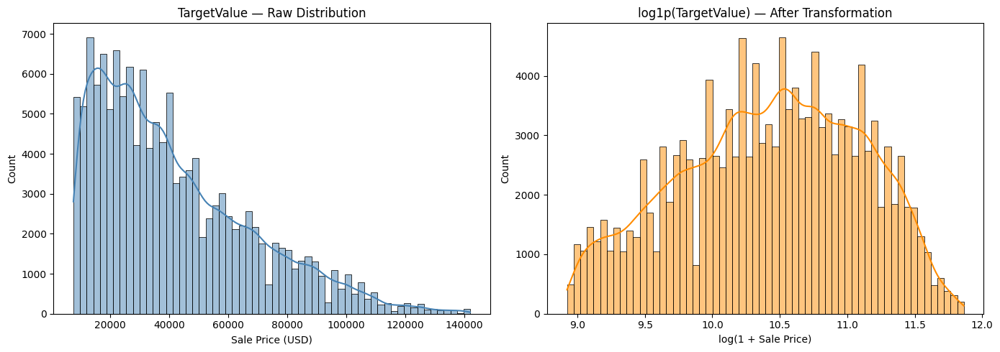
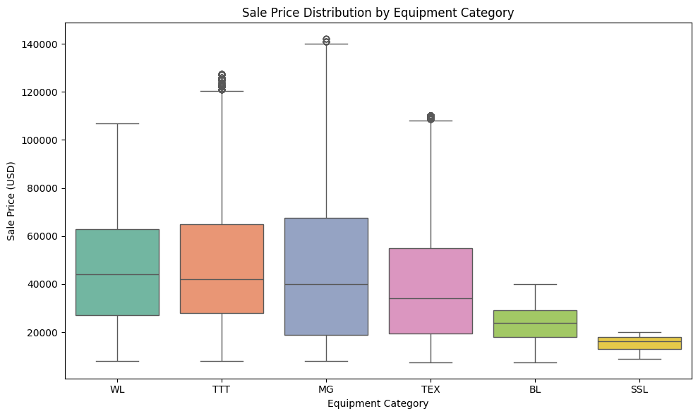
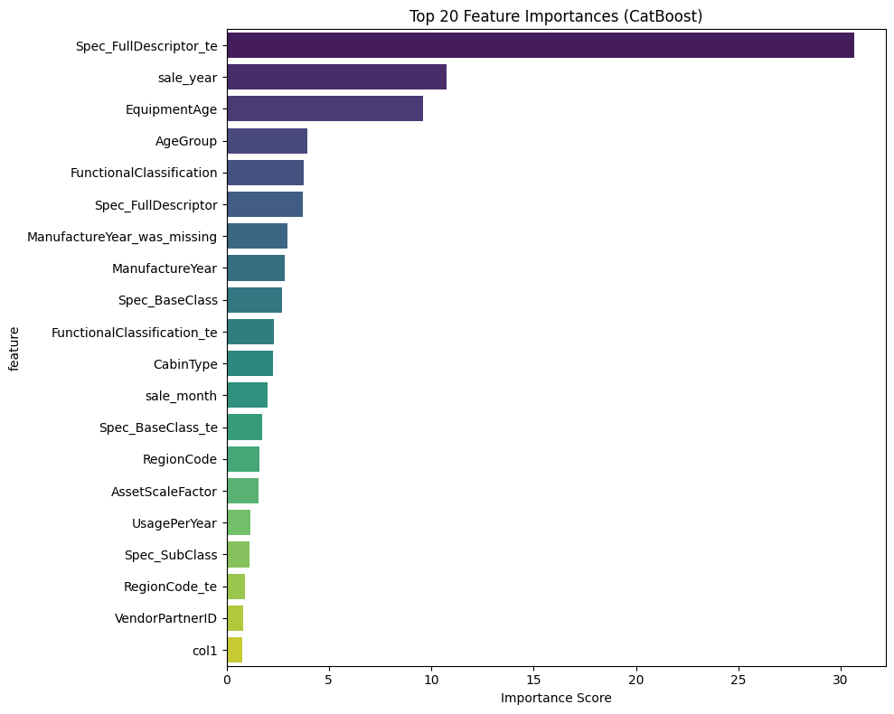
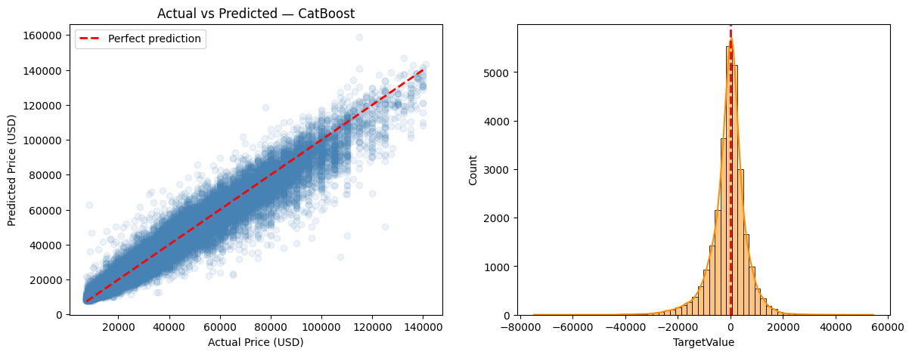

# Heavy Equipment Auction Price Prediction

Capstone project for IITM *Machine Learning Practice*. Predict the sale price of used heavy machinery (excavators, wheel loaders, bulldozers, backhoes…) from specs, usage history and transaction details.

**Result: Kaggle leaderboard RMSLE 0.198** (CatBoost, retrained on the full training set).

## Problem

| | |
|---|---|
| Target | `TargetValue` – sale price in USD |
| Metric | RMSLE (so the model is trained on `log1p(TargetValue)`) |
| Train / test | 138,701 / 15,000 rows |
| Features | 50 columns, 44 categorical, only 2 genuinely numeric (`ManufactureYear`, `OperationalHoursMeter`) |
| Source | Kaggle course competition *heavy-equipment-selling-price-prediction-challenge* |

Price is right-skewed (skew 0.97); after `log1p` it is near symmetric (−0.20), which also matches the metric.

## Approach

1. **Missing-value analysis.** Tested each high-missing column per machine category. Columns that were 100 % present or 100 % absent inside every category (e.g. `col1`: present only for backhoes and motor graders) are *structural* — the attribute simply doesn't exist for that machine type — so they were filled with `"Not Applicable"` rather than imputed.
2. **Sentinel/outlier fixes.** `ManufactureYear = 1001` (14,719 rows) and meter readings > 100,000 h are impossible; set to missing, median-imputed, and a `*_was_missing` flag kept because missingness itself carried signal (`ManufactureYear_was_missing` is in the top 10 features).
3. **Feature engineering.** `EquipmentAge` (sale year − build year), `UsagePerYear`, age buckets, decade buckets, hours relative to category median, sale year/month/day-of-week.
4. **Encoding.** One-hot for ≤ 20-level columns; **smoothed out-of-fold target encoding** (5-fold, smoothing k = 10) for high-cardinality columns such as `Spec_FullDescriptor` — computed out-of-fold so the encoding never sees the row it is encoding.
5. **Models.** Four families compared on an 80/20 split (seed 42).
6. **Final model.** CatBoost with native categorical handling, depth 8, lr 0.03, 9,241 iterations, retrained on all rows.

## Results

| Model | Family | Val RMSLE |
|-------|--------|-----------|
| Ridge | Linear | 0.2947 |
| Random Forest | Bagging | 0.2216 |
| LightGBM (GPU) | Gradient boosting | 0.2133 |
| **CatBoost** | Gradient boosting | **0.2024** |

Leaderboard (CatBoost, full-data retrain): **0.198**.

Trees beat the linear model by a wide margin, as expected with 44 categorical columns and almost no numeric signal. CatBoost won because it handles high-cardinality categoricals natively and needed the least preprocessing.

### What drives price

The smoothed target encoding of the machine's full specification string is the single most important feature, followed by sale year (market conditions / inflation) and equipment age.

### Fit

The plot below uses the final model on rows it was trained on, so treat it as a *fit* diagnostic; the held-out numbers are the validation RMSLE above and the leaderboard score.

## Limitations and next steps

- Random (not time-based) split: sale year is a strong feature, so a chronological split would be a more honest estimate of future performance.
- No blending yet; averaging CatBoost and LightGBM predictions is the obvious next gain.
- Hyperparameters were hand-tuned; Optuna search would be a natural next step.
- Under-prediction at the high end of the price range (see scatter plot).

## Files

- `heavy_equipment_price_prediction.ipynb` – full analysis, run on Kaggle (GPU).
- `data/README.md` – how to obtain the data.
